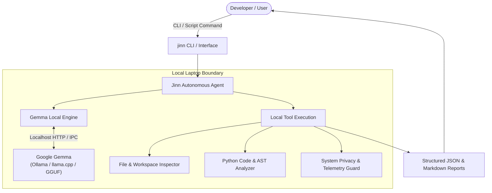

# Jinn — Autonomous Local AI Powered by Google Gemma

[](https://github.com/DikshantJangra/Jinn/actions/workflows/ci.yml)
[](https://opensource.org/licenses/MIT)
[](https://ai.google.dev/gemma)
[](https://www.python.org/)
[](#privacy-guarantee)

> **Hackathon Submission:** Special Track: Gemma  
> **Problem Statement:** PROBLEM 08 — Build Anything with Gemma – Local AI Innovation Challenge  
> **Team:** Jinn (Dikshant Jangra, Somraj, Ritesh)  
> **Repository:** [https://github.com/DikshantJangra/Jinn](https://github.com/DikshantJangra/Jinn)

---

## Overview

**Jinn** is a zero-egress, autonomous local AI companion engineered specifically around **Google Gemma**. Designed as an intelligent on-device "genie", Jinn operates simultaneously as:
1. **A Native macOS HUD Desktop Agent (`app/`)**: An always-on, floating overlay activated with `⌥ + Space`. Features an interactive 3D voxel genie lamp, hands-free on-device voice control, semantic memory via local embeddings, and deep macOS Accessibility / Chrome automation.
2. **A Python Autonomous Core & CLI (`jinn/`)**: A zero-dependency scriptable engine for headless task decomposition, repository AST auditing, and automated verification.
All intelligence runs **100% locally on your laptop** with **zero telemetry or cloud data leakage**, minimal latency, and strict human-in-the-loop safety boundaries.

---

## Key Features

- **100% Local Inference:** Driven by Google Gemma (`gemma4:e4b`, `gemma4:e2b`, `gemma2:2b/9b`) via [Ollama](https://ollama.ai) or any OpenAI-compatible runner (llama.cpp, LM Studio, vLLM).
- **Floating macOS HUD with 3D Voxel Lamp:** Instant `⌥ + Space` hotkey summons an always-on floating glass panel displaying a real-time, interactive Three.js voxel Genie lamp that visually reacts to agent thinking, voice input, and execution states.
- **On-Device Voice Interaction:** Speak commands naturally using Apple's private, on-device speech recognition framework (hold `⌥ + Space` to talk, release to execute).
- **Desktop & Browser Hands:**
  - **macOS Accessibility (AX):** Inspects the UI tree, prunes to token budgets, and executes targeted clicks, text entry, and window controls.
  - **Google Chrome Bridge:** Automated form-filling and web interactions via Chrome DevTools Protocol (`--remote-debugging-port=9222`).
- **Semantic Long-Term Memory:** Indexes local personal notes and user profile (`me.md`) via on-device embeddings (`nomic-embed-text`) stored in `~/Library/Application Support/Jinn/notes`.
- **Human-in-the-Loop Safety Model:**
  - Dangerous shell commands are classified and blocked via strict safety policies.
  - Three-tier approval system: `.safe` (auto-run), `.app` (asks permission once per app), and `.confirm` (always prompts in HUD).
  - Password and secure text fields (`AXSecureTextField`) are strictly blocked from being read or typed into.
- **Zero Cloud Egress Guarantee:** No network sockets leave `localhost`. Code, proprietary files, voice recordings, and sensitive system telemetry stay strictly on your machine.
---

## Architecture


For comprehensive details on architectural layers, stale element detection, token pruning, and reference attributions, see [docs/ARCHITECTURE.md](docs/ARCHITECTURE.md).
---

## Quickstart & Installation

### 1. Prerequisites
- macOS 14.0+ (Sonoma or Sequoia) for the native HUD app.
- Python 3.9+ for the Python core and CLI tools.
- [Ollama](https://ollama.ai) installed and running.

### 2. Pull Gemma Locally (Recommended)
```bash
# Recommended default (4B model + local embeddings for memory)
ollama pull gemma4:e4b
ollama pull nomic-embed-text
# For 8GB RAM laptops (lightweight setup)
ollama pull gemma4:e2b
```
---
## Option A: Native macOS HUD Agent (`app/`)
### 1. Build and Launch
```bash
git clone https://github.com/DikshantJangra/Jinn.git
cd Jinn
# Build the release app and ad-hoc sign it
./app/build.sh
# Launch Jinn
open app/build/Jinn.app
```
### 2. Grant Permissions
On first launch, macOS will prompt for permissions necessary to inspect and drive applications:
- **Accessibility:** Required to navigate UI trees and click elements.
- **Microphone & Speech Recognition:** Required for voice dictation.
- **Automation:** Prompted per-app when Jinn first controls an external app.
### 3. Controls & Hotkeys
| Trigger | Action |
| :--- | :--- |
| `⌥ + Space` *(Tap)* | Toggle the floating HUD overlay open / closed |
| `⌥ + Space` *(Hold)* | Listen to microphone dictation (Voxel lamp pulses) |
| `⌥ + Space` *(Release)* | Send voice input to Gemma and execute plan |
| `Esc` | Dismiss HUD and cancel active speech or tool execution |
### 4. Headless & Developer CLI Modes
You can test the macOS engine directly from your terminal:
```bash
# Run self-tests (checks brain, loop, and safety)
app/build/Jinn.app/Contents/MacOS/Jinn --selftest
# Run headless query with execution trace
app/build/Jinn.app/Contents/MacOS/Jinn --ask "organize my downloads folder"
# Direct tool testing without model invocation
app/build/Jinn.app/Contents/MacOS/Jinn --tool app_state '{"app":"Finder"}'
```
---
## Option B: Python Core & CLI (`jinn/`)
### 1. Setup Environment
```bash
pip install -r requirements.txt
pip install -e .
```
### 2. CLI Usage
```bash
# Check system telemetry and local Gemma availability
jinn info
# Plan a complex multi-step task with Gemma
jinn plan "Refactor authentication flow and write unit tests"
# Perform a local, offline security & structure audit
jinn audit --dir .
```
### 3. Run Automated Tests
```bash
# Run test suite
python3 -m unittest discover tests
# Or with pytest
pytest -v
```
All pushes and pull requests to `main` are automatically verified through the [CI Pipeline](.github/workflows/ci.yml).

---
## Configuration & Environment Variables
| Variable | Default | Description |
| :--- | :--- | :--- |
| `JINN_MODEL` | `gemma4:e4b` | Primary Gemma model to run via Ollama or custom backend |
| `JINN_BIG_MODEL` | *None* | Escalation model triggered for stalls or deep reasoning tasks |
| `JINN_BACKEND` | `ollama` | Backend type: `ollama` or `openai` (for LM Studio, llama.cpp, vLLM) |
| `JINN_BASE_URL` | `http://localhost:11434` | Custom endpoint URL for local inference engine |
---

## Repository Structure

```
Jinn/
├── .github/
│   ├── workflows/
│   │   └── ci.yml                 # Automated testing and verification CI
│   └── pull_request_template.md   # Required PR submission template
├── examples/
│   ├── demo_run.py                # Executable demonstration script
│   ├── input_task_planning.json   # Sample input for task planning
│   ├── output_task_planning.json  # Generated plan output from Gemma
│   ├── input_code_audit.json      # Sample input for workspace audit
│   └── output_code_audit.json     # Generated audit output
├── jinn/
│   ├── __init__.py                # Package metadata
│   ├── agent.py                   # Autonomous agent coordinator
│   ├── cli.py                     # Command-line interface
│   ├── engine.py                  # Local Gemma model interface
│   ├── prompts.py                 # Gemma prompt templates & turn formatting
│   └── tools.py                   # Local privacy-preserving system tools
├── tests/
│   ├── __init__.py
│   ├── test_agent.py              # Agent unit tests
│   ├── test_engine.py             # Inference engine tests
│   ├── test_prompts.py            # Prompt formatting tests
│   └── test_tools.py              # Local toolkit tests
├── HACKATHON.md                   # Hackathon details and model selection rationale
├── LICENSE                        # MIT Open Source License
├── requirements.txt               # Project dependencies
├── setup.py                       # Python packaging configuration
└── README.md                      # Project documentation
```
---
## Safety, Privacy & Approvals
Jinn adheres to a strict zero-trust local security model:
1. **Never Leaks Data:** No cloud dependencies, analytics, or outbound telemetry calls.
2. **Human-in-the-Loop Approvals:**
   - Destructive operations (`run_shell`, external app writes) present interactive approval dialogs inside the HUD.
   - Per-app permissions can be approved once or persisted to `~/Library/Application Support/Jinn/approvals.json`.
3. **Shell Command Classifier:** Blocks dangerous command patterns (e.g., `rm -rf /`, `mkfs`, raw block devices).
4. **Credential Isolation:** Password inputs and secure UI elements (`AXSecureTextField`) are masked and unreachable by agent tools.
---

## Team Details

- **Team Name:** Jinn
- **Members:**
  - Dikshant Jangra
  - Somraj
  - Ritesh
- **Track:** SPECIAL TRACK: GEMMA
- **Problem Statement:** PROBLEM 08: Build Anything with Gemma – Local AI Innovation Challenge
- **Submission Deadline:** 8:30 PM, 31 October 2026

---

## License & Attribution
- Jinn's core Python library and original Swift components are licensed under the **MIT License** - see [LICENSE](LICENSE).
- Portions of the macOS automation ("Hands") layer adapt design patterns from [`mac-cua`](https://github.com/hyprcat/mac-cua) under **Apache-2.0**.
- Specific safety and tool parsing utilities in `app/` are adapted from [`Agent!`](https://github.com/macos26/Agent) under **PolyForm Noncommercial 1.0.0**.
- The 3D Genie Lamp utilizes [`three.js`](https://threejs.org) under the **MIT License**.
See [NOTICE](NOTICE) for complete attribution and licensing details.
